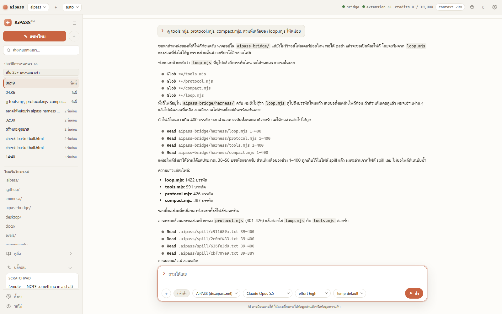

# ✳ AiPASS Desktop — AI coding agent ภาษาไทย สำหรับ Windows, macOS, Linux

[English](./README.md) · **ไทย**

> **หน้าต่างเดสก์ท็อปและ agent harness สำหรับ [de.aipass.net](https://de.aipass.net/chat)** —
> agent ที่แก้ไฟล์ได้และดูได้ทุกขั้นตอน หยุด/อนุมัติ/ทำงานต่อได้ ผ่าน bridge ที่คุยกับเว็บ
> ด้วยแท็บเบราว์เซอร์ที่คุณล็อกอินอยู่แล้ว

> **โปรเจกต์ชุมชนอิสระ** ไม่ได้เกี่ยวข้อง ไม่ได้รับการรับรอง และไม่ได้สนับสนุนโดยผู้ให้บริการ
> de.aipass.net ดู [TRADEMARK.md](./TRADEMARK.md)



<p align="center">
  <em>ธีมสว่าง (v0.2.0) — sessions อยู่ซ้าย ต้นไม้ไฟล์อยู่ใต้ แล้วบทสนทนาอยู่กลาง ทุก tool call เป็นแถวที่เปิดดูได้ แผง pending การเปลี่ยน (ติ๊กไฟล์ + diff) และภาพ dark อยู่ระหว่างถ่ายใหม่ — ไม่มีในภาพนี้</em>
</p>

> **สถานะ: pre-1.0 ยังไม่มี installer** — ตอนนี้ติดตั้งจาก source (ดูด้านล่าง) แอป native
> ตรวจสอบบน **Windows** แล้ว — macOS/Linux build เรียบร้อยแต่ถือว่า “ลองใช้ได้” ไม่ใช่
> พร้อมแจกจริงจนกว่าจะมีคนรัน end-to-end บนเครื่องเหล่านั้น ดู [ROADMAP.md](./ROADMAP.md)

| แพลตฟอร์ม | หน้าต่างในเบราว์เซอร์ | แพ็กเกจ native (Tauri) |
|---|---|---|
| Windows | พร้อมใช้ | NSIS ตรวจสอบแล้ว (รัน+ปิด tray ได้จริง) |
| macOS | พร้อมใช้ | `.app/.dmg` ยังเป็น ready-to-try |
| Linux | พร้อมใช้ | `deb/AppImage` ยังเป็น ready-to-try |

### เริ่มใน 30 วินาที

```bash
git clone https://github.com/kasemjeff/aipass-desktop.git
cd aipass-desktop
npm run setup     # ตรวจ Node, สร้าง token, ใส่ PATH, เริ่ม bridge, เปิดหน้าเว็บ
npm run desktop   # เปิดหน้าต่างที่ http://127.0.0.1:8790
```

จากนั้นโหลด extension ครั้งเดียว (`chrome://extensions` → Developer mode → Load unpacked → `aipass-bridge/extension`) แล้ววาง token ใน popup

💬 [คุยและแชร์ workflow ใน Discussions](https://github.com/kasemjeff/aipass-desktop/discussions) ·
🐛 [แจ้งปัญหาหรือเสนอไอเดีย](https://github.com/kasemjeff/aipass-desktop/issues/new/choose) ·
⭐ [กด Star ถ้า repo นี้มีประโยชน์](https://github.com/kasemjeff/aipass-desktop)

**เหมาะกับใคร:** ผู้ใช้ Windows ภาษาไทย ที่อยากได้ agent แก้ไฟล์ที่ดูได้ อนุมัติได้ resume ได้
**ยังไม่เหมาะกับใคร:** คนที่ต้องการ installer macOS/Linux ที่เซ็นแล้ววันนี้ — ใช้แบบเบราว์เซอร์ไปก่อน

## สถานะ

- เวอร์ชัน **pre-1.0** และยังไม่มี installer/GitHub Release ที่เผยแพร่ — ติดตั้งจาก source
  ตามด้านล่าง
- CI รันชุดทดสอบบน Ubuntu, macOS และ Windows ด้วย Node 24
- Rust shell มี unit test บน Ubuntu และ Windows, coverage floor, docs link check,
  eval-set lint และ CodeQL ผ่าน
- Node floor คือ 24 (ตรงกับ `.nvmrc` และ sidecar); Node 20/22 ไม่รองรับอีกต่อไป
- สิ่งที่ยังไม่พร้อมอยู่ใน [ROADMAP.md](./ROADMAP.md) และข้อจำกัดที่รู้อยู่แล้วอยู่ใน
  [SECURITY.md](./SECURITY.md) กับ [docs/MATURITY.md](./docs/MATURITY.md)

## สิ่งที่ repo นี้มี

- **`desktop/`** — หน้าต่างแอป: โปรเจกต์, รายการแชท, transcript ที่ resume/fork ได้,
  diff ต่อไฟล์ให้อนุมัติ, plan card, โหมดสิทธิ์, file panel, playbook และ plugin
- **`aipass-bridge/harness/`** — แกน agent: loop, tools, protocol, session บนดิสก์,
  compaction, permission/path rules, WAF, provider, plugin และ MCP
- **`aipass-bridge/`** — bridge และ Chrome extension ที่สืบต่อจาก
  [niawjunior/aipass-bridge](https://github.com/niawjunior/aipass-bridge) — `agent.mjs`
  คือ runner ครั้งเดียว (one-shot) ที่ scheduler เรียกใช้ ไม่มีคำสั่ง `aipass` ในเทอร์มินัลแล้ว

หน้าต่างและ agent ใช้ `~/.aipass/settings.json` ไฟล์เดียวกัน ค่าที่เปลี่ยนจึงมีผล
ทุกที่ทันที

## ติดตั้งจาก source

ต้องมี:

| สิ่งที่ต้องมี | เหตุผล |
|---|---|
| **Node ≥ 24** | ใช้ `node:*` builtins เท่านั้น ไม่ต้องติดตั้ง dependency |
| **Chrome หรือ Chromium** | extension เป็นส่วนเดียวที่แตะ session ของคุณ |
| **บัญชี de.aipass.net** | แท็บที่ล็อกอินอยู่คือ credential |

```bash
git clone https://github.com/kasemjeff/aipass-desktop.git
cd aipass-desktop
npm run setup
```

`setup` จะตรวจ Node, สร้าง `~/.aipass/` และ token, คัดลอก token,
เริ่ม bridge และเปิดหน้าเว็บ/หน้า extensions ให้

### สองขั้นตอนในเบราว์เซอร์ (ครั้งเดียว)

1. เปิด `chrome://extensions` → **Developer mode** → **Load unpacked** →
   เลือกโฟลเดอร์ `aipass-bridge/extension`
2. เปิด popup ของ extension → **Advanced** → **Loopback token** → วางเนื้อหา
   `~/.aipass/.token` → บันทึก แล้วเปิด <https://de.aipass.net/chat> ล็อกอินและเปิดแท็บนั้นไว้

สถานะอยู่ที่ header ของหน้าต่าง หรือถาม bridge ตรง ๆ ที่ `GET /status`

### หน้าต่างเดสก์ท็อป

```bash
npm run desktop       # เปิดหน้าต่างในเบราว์เซอร์ที่ 127.0.0.1:8790
npm run tauri:build   # build installer: NSIS / .app/.dmg / deb/appimage
```

การ build native ต้องมี Rust toolchain และ Tauri CLI เพิ่ม ดู
[docs/INSTALL.md](./docs/INSTALL.md) และ [desktop/README.md](./desktop/README.md)

## คำสั่งที่ใช้บ่อย

```bash
npm test              # ชุดทดสอบทั้งหมด
npm run typecheck     # ไฟล์ที่เปิด // @ts-check
npm run docs:check    # ลิงก์ Markdown ที่เป็น relative
npm run coverage:gate # coverage floor ต่อไฟล์
npm run check         # ก่อน push: lint + test + qa + coverage + docs
```

## เอกสาร

เริ่มที่ [docs/README.md](./docs/README.md) โดยเฉพาะ:

- [ติดตั้ง](./docs/INSTALL.md)
- [แก้ปัญหา](./docs/TROUBLESHOOTING.md)
- [คำถามที่พบบ่อย](./docs/FAQ.md)
- [การย้ายจาก upstream](./docs/MIGRATION.md)
- [สถาปัตยกรรม harness](./docs/HARNESS_DESIGN.md)
- [การ release](./docs/RELEASE.md)
- [ความปลอดภัย](./SECURITY.md)

## ชุมชนและการมีส่วนร่วม

วิธีช่วยที่เร็วที่สุดคือทดลองทำงานจริงหนึ่งงานแล้วเล่าให้เราฟัง:

1. [ถามคำถามหรือแชร์ workflow ใน Discussions](https://github.com/kasemjeff/aipass-desktop/discussions)
2. [แจ้งปัญหาที่ทำซ้ำได้หรือเสนอฟีเจอร์ผ่าน issue form](https://github.com/kasemjeff/aipass-desktop/issues/new/choose)
3. [ทดสอบบน OS ของคุณ](./docs/PLATFORM_CHECKLIST.md) แล้วบอกเวอร์ชัน Node และผลที่ได้
4. [ส่ง pull request](./CONTRIBUTING.md) — เอกสาร test และคำแปลล้วนช่วยได้

เวลาแจ้งปัญหา ให้ใส่งานที่ลองทำ ผลลัพธ์ที่คาดหวัง และผลลัพธ์จริง
อย่าใส่ token path โปรเจกต์ส่วนตัว หรือข้อมูลลูกค้าใน issue
ถ้า repo นี้ช่วยคุณได้ การกด Star หรือเล่าสั้น ๆ ว่าเอาไปสร้างอะไรช่วยให้คนอื่นกล้าลองมากขึ้น

## ผู้ร่วมพัฒนา

**kasemjeff** เป็นผู้ร่วมพัฒนาเพียงคนเดียวของ repo นี้ ดู [AUTHORS.md](./AUTHORS.md)

โค้ด bridge, extension และ CLI สืบต่อจาก upstream ซึ่งมี **niawjunior**
และผู้เขียนคนอื่น ๆ เป็นเจ้าของลิขสิทธิ์เดิม ข้อความลิขสิทธิ์อยู่ใน
[LICENSE](./LICENSE) และ [NOTICE](./NOTICE) ไม่ได้ถูกลบ

## ร่วมพัฒนา

1. อ่าน [CONTRIBUTING.md](./CONTRIBUTING.md) และ [CODE_OF_CONDUCT.md](./CODE_OF_CONDUCT.md)
2. ทุก commit ต้องมี `Signed-off-by` — ใช้ `git commit -s`
3. รัน `npm test`, `npm run typecheck`, `npm run agents:lint` และ `npm run docs:check`
4. เพิ่ม test ทุกครั้งที่เปลี่ยนพฤติกรรม และรักษา core ให้ไม่มี runtime dependency

## ความปลอดภัย

อย่าเปิด issue สาธารณะสำหรับช่องโหว่ ให้ใช้
[private vulnerability reporting](https://github.com/kasemjeff/aipass-desktop/security/advisories/new)
และอ่าน [SECURITY.md](./SECURITY.md)

## สนับสนุนและติดต่อ

- [GitHub Discussions](https://github.com/kasemjeff/aipass-desktop/discussions)
- [SUPPORT.md](./SUPPORT.md)
- [PRIVACY.md](./PRIVACY.md) — ไม่มี telemetry
- [GOVERNANCE.md](./GOVERNANCE.md) และ [MAINTAINERS.md](./MAINTAINERS.md)

## Quick fixes (เจออาการก่อน)

| อาการ | ลองทำเลย |
|---|---|
| ไม่มีแท็บ `de.aipass.net` / extension ×0 | เปิด Chrome ล็อกอินและเปิดแท็บ `de.aipass.net/chat` ไว้ |
| 401 / token ผิด | ปิดแล้วเปิด `aipass` ใหม่ (backend กับ bridge ต้องอ่าน token เดียวกัน) — ดู `~/.aipass/.token` |
| `port 8790 is busy` | ปิด backend ตัวเก่า หรือรัน `aipass stop` แล้วเปิดใหม่ |
| เครดิต 0 / quota หมด | รอรอบถัดไป หรือสลับโมเดล free-credit (`gemini-3.1-flash-lite`) |
| ต้องการรายละเอียดทั้งหมด | [TROUBLESHOOTING.md](./docs/TROUBLESHOOTING.md) · `aipass doctor` |

## สัญญาอนุญาต

[MIT License](./LICENSE) — ซอฟต์แวร์ bundled บุคคลที่สามดู
[THIRD_PARTY_NOTICES.md](./THIRD_PARTY_NOTICES.md)
